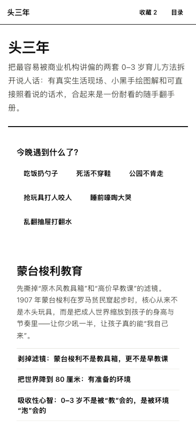

# The First Three Years

[简体中文](README.md) · [Open the site](https://first-three-years.xiaosang.cc/) · [GitHub](https://github.com/holynova/first-three-years)

Choose the Montessori or Positive Discipline guide, then turn to an age-specific home checklist or a conversation exercise. The two Chinese-language guides span seven and six chapters, with 23 hand-drawn illustrations.



Start with a familiar situation at home. Use the checklist to pick one idea to try, or work through the dialogue exercise on your phone.

## Run locally

```sh
npm run build
npm run validate
npm run dev
```

Publish the Cloudflare Worker from `main` with `npm run deploy`.

<a href="https://first-three-years.xiaosang.cc/"></a>
