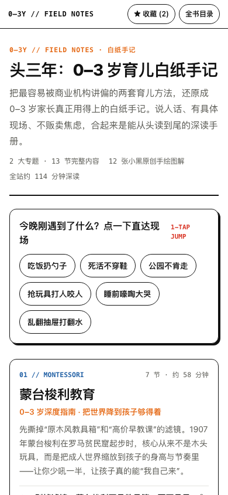

# 头三年 · First Three Years

中文：专为 0–3 岁家长编写的移动端优先育儿科普手册。采用「白纸手记」极简排版，包含蒙台梭利教育（7 节）与正面管教（6 节）完整长文、12 张小黑纯白手绘图解，以及分月龄改造与高频崩盘话术对照工具。

English: A mobile-first parenting handbook for ages 0–3 built with a clean white-sketchbook interface. It pairs full-length Chinese guides on Montessori education (7 chapters) and Positive Discipline (6 chapters) with 12 custom hand-drawn illustrations, age-specific home checklists, and interactive conflict scripts.



## 在线体验 / Live Demo

- [Cloudflare Demo](https://first-three-years.xiaosang.cc/)
- [GitHub Repo](https://github.com/holynova/first-three-years)


## 本地运行 / Run locally

```bash
npm run build
npm run validate
npm run dev
```

## 发布 / Deploy

```bash
npm run deploy
```

Cloudflare Workers · Custom Domain: `first-three-years.xiaosang.cc`

源码与部署配置均维护在唯一主分支 `main`；从对应提交在本地构建并执行 `wrangler deploy` 手动发布，不新建 Cloudflare 专用分支或 GitHub Action。
